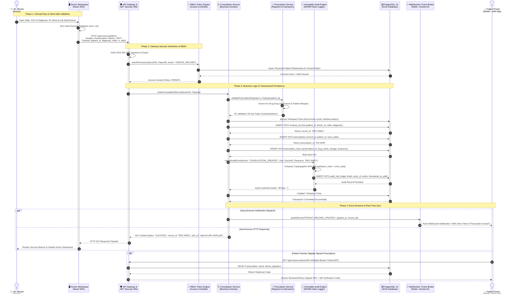
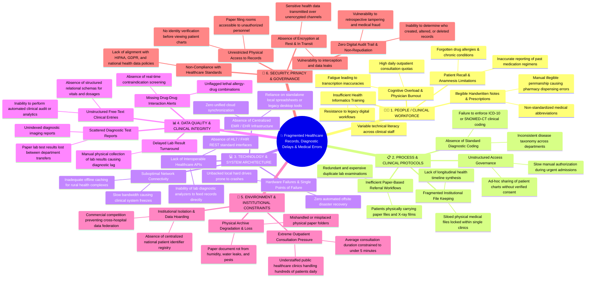

# System Architecture and Diagrams | Web Version

**Notice:** This documentation applies exclusively to the **Web Version** of the MedraLink prototype.

## Recommended Architecture

```text
                    MEDRALINK
                        │
                ┌───────┴───────┐
                │   Frontend    │
                │ React / Next  │
                └───────┬───────┘
                        │ REST API
                ┌───────▼───────┐
                │    Backend    │
                │ Node.js/      │
                │ Express       │
                └───────┬───────┘
                        │
          ┌─────────────┼─────────────┐
          │             │             │
    ┌─────▼─────┐ ┌────▼─────┐ ┌─────▼─────┐
    │ PostgreSQL│ │ File     │ │ Auth /    │
    │ Database  │ │ Storage  │ │ RBAC      │
    └───────────┘ └──────────┘ └───────────┘
```

## Database Entity-Relationship Model

```text
USER
 │
 ├──────────────┐
 │              │
 ▼              ▼
PATIENT       DOCTOR
 │              │
 │              │
 └──────┬───────┘
        │
        ▼
   APPOINTMENT
        │
        ▼
 MEDICAL_RECORD
        │
   ┌────┼───────────────┐
   ▼    ▼               ▼
DIAGNOSIS PRESCRIPTION  LAB_REPORT
                         │
                         ▼
                    DOCUMENT
```

## Authentication & Authorization Flow

```text
User
 ↓
Login
 ↓
JWT Authentication
 ↓
Role Verification
 ↓
Authorization
 ↓
Requested Resource
```

## Patient Medical Timeline Example

```text
                 MEDICAL HISTORY

2026
 │
 ├── Aug 10
 │   ├── General Consultation
 │   ├── Diagnosis: Fever
 │   ├── Prescription: ...
 │   └── Lab Report: CBC
 │
 ├── Jul 22
 │   ├── Follow-up
 │   └── Prescription updated
 │
 └── Jun 14
     └── Initial Consultation
```

## 1. UML Component Diagram

```mermaid
flowchart TB
    %% Styling Classes
    classDef clientStyle fill:#EFF6FF,stroke:#1D4ED8,stroke-width:2px,color:#0F172A;
    classDef gatewayStyle fill:#FFFBEB,stroke:#D97706,stroke-width:2px,color:#0F172A;
    classDef serviceStyle fill:#ECFDF5,stroke:#059669,stroke-width:2px,color:#0F172A;
    classDef dataStyle fill:#FEF2F2,stroke:#DC2626,stroke-width:2px,color:#0F172A;
    classDef secStyle fill:#F5F3FF,stroke:#7C3AED,stroke-width:2px,color:#0F172A;
    classDef interfaceStyle fill:#FFFFFF,stroke:#475569,stroke-width:1.5px,color:#334155,font-size:11px;

    %% 1. PRESENTATION TIER (CLIENT TIER)
    subgraph PresentationTier["🖥️ Presentation Layer (Client Tier - Single Page Applications)"]
        direction TB
        subgraph UI_Modules["Frontend Clients (React 18 • TypeScript • Tailwind CSS)"]
            direction LR
            C_Patient["«component»\nPatient Portal Client\n• Timeline Visualizer\n• Prescription Viewer\n• Lab Report Downloader\n• Hospital Locator"]:::clientStyle
            C_Doctor["«component»\nDoctor Consultation Workspace\n• E-Prescription Builder\n• ICD-10 Diagnosis Module\n• Clinical Vitals Logger"]:::clientStyle
            C_Admin["«component»\nAdmin Management Console\n• User & Doctor Onboarding\n• RBAC Permission Matrix\n• System Audit Inspector"]:::clientStyle
        end
    end

    %% 2. API GATEWAY & SECURITY PERIMETER
    subgraph GatewayTier["🛡️ API Gateway & Security Perimeter (Reverse Proxy & Filter Chain)"]
        direction TB
        I_GatewayPort(["«interface»\nHTTPS / WSS (Port 443)\nRESTful JSON API"]):::interfaceStyle
        
        subgraph SecGateway["Security & Routing Gateway (Express.js / Nginx)"]
            direction LR
            C_RateLimiter["«component»\nRate Limiter &\nDDoS Shield"]:::gatewayStyle
            C_Sanitizer["«component»\nInput Sanitizer &\nXSS / SQLi Filter"]:::gatewayStyle
            C_AuthFilter["«component»\nJWT Authentication\n& Session Validator"]:::secStyle
            C_RBAC_PEP["«component»\nRBAC Policy Enforcement\n(PEP Engine)"]:::secStyle
        end
    end

    %% 3. BUSINESS LOGIC & APPLICATION SERVICES
    subgraph AppServiceTier["⚙️ Business Logic Tier (Application & Domain Services)"]
        direction TB
        
        subgraph PatientSubsystem["Patient Domain Subsystem"]
            C_PatientSvc["«component»\nPatientManagementService\n• Demographics & Identity\n• Longitudinal Timeline Builder\n• Emergency Profile Engine"]:::serviceStyle
        end

        subgraph ClinicalSubsystem["Clinical Domain Subsystem"]
            direction LR
            C_ConsultSvc["«component»\nConsultationService\n• Chief Complaints\n• Vitals & Biometrics\n• ICD-10 Diagnostics"]:::serviceStyle
            C_RxSvc["«component»\nEPrescriptionService\n• Drug Interaction Checker\n• Dosage & Regimen Engine\n• PDF / QR Code Generator"]:::serviceStyle
            C_LabSvc["«component»\nLabDocumentService\n• MIME & Virus Scanner\n• File Chunker / Streamer\n• Report Indexer"]:::serviceStyle
        end

        subgraph CorePlatformSubsystem["Platform Core & Governance Subsystem"]
            direction LR
            C_AuditSvc["«component»\nAuditLoggingEngine\n• WORM Compliance Logger\n• Cryptographic Hash Chain\n• Access Traceability"]:::secStyle
            C_NotifySvc["«component»\nNotificationService\n• WebSocket Realtime Push\n• SMS / Email Gateway\n• Critical Vitals Alert"]:::serviceStyle
        end
    end

    %% 4. PERSISTENCE & DATA STORAGE TIER
    subgraph PersistenceTier["🗄️ Persistence & Storage Tier"]
        direction TB
        
        subgraph DataAccessLayer["Data Access & ORM Subsystem"]
            C_ORM["«component»\nPrisma / PostgreSQL DAO Layer\n• Connection Pooling (PgBouncer)\n• ACID Transaction Manager\n• Prepared Statement Execution"]:::dataStyle
        end

        subgraph PhysicalStores["Enterprise Storage Repositories"]
            direction LR
            DB_Relational[("«database»\nPostgreSQL 16 Cluster\n• users & auth_credentials\n• patients & doctors\n• consultations & diagnoses\n• prescriptions & items\n• audit_trail_ledger (Append-Only)")]:::dataStyle
            Store_Objects[("«storage»\nEncrypted File Vault\n• AES-256 GCM Object Store\n• Diagnostic Lab Scans (PDF/DICOM)\n• Digitally Signed Prescriptions")]:::dataStyle
        end
    end

    %% 5. SECURITY PROTOCOL & REGULATORY GOVERNANCE SPECIFICATIONS
    subgraph SecurityTier["🔒 Cross-Cutting Security Protocol & Regulatory Governance"]
        direction LR
        Sec_Auth["«specification»\nAuthentication & Authorization\n• Stateless RSA-256 JWT Verify\n• Argon2id Password Hashing\n• Dynamic RBAC Policy Matrix"]:::secStyle
        Sec_Enc["«specification»\nIntegrity & Encryption\n• TLS 1.3 Strict HTTPS/WSS\n• AES-256 GCM File Vault at Rest\n• Prisma SQLi Defense"]:::secStyle
        Sec_Audit["«specification»\nAudit & Compliance\n• WORM Append-Only Ledger\n• SHA-256 Cryptographic Chain\n• HIPAA & GDPR Traceability"]:::secStyle
    end

    %% Connections
    C_Patient -->|"HTTPS / REST"| I_GatewayPort
    C_Doctor -->|"HTTPS / REST"| I_GatewayPort
    C_Admin -->|"HTTPS / REST"| I_GatewayPort

    I_GatewayPort --> C_RateLimiter
    C_RateLimiter --> C_Sanitizer
    C_Sanitizer --> C_AuthFilter
    C_AuthFilter --> C_RBAC_PEP

    %% Gateway to Services
    C_RBAC_PEP -->|"Dispatches to"| C_PatientSvc
    C_RBAC_PEP -->|"Dispatches to"| C_ConsultSvc
    C_RBAC_PEP -->|"Dispatches to"| C_RxSvc
    C_RBAC_PEP -->|"Dispatches to"| C_LabSvc

    %% Service-to-Service Cross-Cutting Interactions
    C_ConsultSvc -->|"Links Record"| C_PatientSvc
    C_ConsultSvc -->|"Triggers Rx"| C_RxSvc
    C_ConsultSvc -->|"Attaches Tests"| C_LabSvc
    
    C_ConsultSvc -.->|"Audit Event"| C_AuditSvc
    C_RxSvc -.->|"Audit Event"| C_AuditSvc
    C_LabSvc -.->|"Audit Event"| C_AuditSvc
    C_PatientSvc -.->|"Audit Event"| C_AuditSvc

    C_ConsultSvc -->|"Dispatches Alert"| C_NotifySvc
    C_RxSvc -->|"Dispatches Alert"| C_NotifySvc

    %% Services to Data Access Layer
    C_PatientSvc --> C_ORM
    C_ConsultSvc --> C_ORM
    C_RxSvc --> C_ORM
    C_LabSvc --> C_ORM
    C_AuditSvc --> C_ORM

    %% Data Access to Storage
    C_ORM -->|"SQL Queries / Transactions"| DB_Relational
    C_LabSvc -->|"Encrypted Binary Stream (AES-256)"| Store_Objects
```



## 2. UML Activity Diagram

```mermaid
flowchart TD
    %% Node Styles
    classDef startEnd fill:#0F172A,stroke:#38BDF8,stroke-width:2.5px,color:#FFFFFF;
    classDef decision fill:#FEF3C7,stroke:#D97706,stroke-width:2px,color:#92400E,font-weight:bold;
    classDef action fill:#FFFFFF,stroke:#2563EB,stroke-width:1.5px,color:#0F172A;
    classDef sysAction fill:#FFFFFF,stroke:#059669,stroke-width:1.5px,color:#0F172A;
    classDef dbAction fill:#FFFFFF,stroke:#DC2626,stroke-width:1.5px,color:#0F172A;
    classDef ptAction fill:#FFFFFF,stroke:#7C3AED,stroke-width:1.5px,color:#0F172A;
    classDef barStyle fill:#0F172A,stroke:#0F172A,stroke-width:3px;
    classDef errorState fill:#FEF2F2,stroke:#DC2626,stroke-width:1.5px,color:#991B1B;

    %% 1. DOCTOR SWIMLANE
    subgraph Lane_Doctor["👨‍⚕️ Healthcare Provider (Doctor)"]
        direction TB
        A_Start((●)):::startEnd --> A_Search["Search Patient\n(by National ID / Medra-UID)"]:::action
        A_Search --> A_WaitAuth["Await Security Authorization"]:::action
        A_RenderHist["Review Patient Medical Timeline,\nAllergies & Historical Records"]:::action --> A_EnterConsult["Enter Clinical Vitals, Symptoms\n& ICD-10 Diagnoses"]:::action
        A_EnterConsult --> Fork_Clinical{"═════ FORK (Concurrent Clinical Tasks) ═════"}:::barStyle
        
        Fork_Clinical --> A_WriteRx["Formulate E-Prescription\n• Drug Name, Dosage, Regimen\n• Automated Interaction Check"]:::action
        Fork_Clinical --> A_OrderLabs["Order Diagnostic Tests\n• Select Lab Requisitions\n• Attach Digital Scans / PDFs"]:::action
        
        A_WriteRx --> Join_Clinical{"═════ JOIN (Synchronize Tasks) ═════"}:::barStyle
        A_OrderLabs --> Join_Clinical
        
        Join_Clinical --> A_Finalize["Review Summary & Click\n'Finalize & Sign Consultation'"]:::action
        A_FixErrors["Correct Formatted Fields &\nDrug Conflict Warnings"]:::action --> A_Finalize
    end

    %% 2. CLIENT SPA SWIMLANE
    subgraph Lane_Client["🖥️ Client Application (Web / Mobile SPA)"]
        direction TB
        B_Debounce["Debounce Input & Dispatch\nHTTPS GET /api/v1/patients/:id"]:::action
        B_ClientValid["Execute Client-Side JSON Schema\n& Input Sanitization Checks"]:::action
        B_DispatchRecord["Emit Encrypted Payload with JWT\nPOST /api/v1/consultations"]:::action
        B_RenderSuccess["Render Real-Time Success Toast\n& Load Printable Digital Record"]:::action
    end

    %% 3. SYSTEM & SECURITY GATEWAY SWIMLANE
    subgraph Lane_System["⚙️ MedraLink Security & Core Services Engine"]
        direction TB
        C_TokenCheck{"Validate JWT &\nRBAC Session?"}:::decision
        C_Deny["Log Security Violation &\nGenerate 403 Forbidden"]:::errorState
        C_ConsentCheck{"Doctor Assigned or\nBreak-Glass Emergency?"}:::decision
        
        C_FetchTimeline["Query Timeline Aggregator &\nDecrypt Longitudinal Record"]:::sysAction
        
        C_ValidateTx{"Validate Business Logic\n& Drug Contraindications?"}:::decision
        C_FormatErrors["Return 422 Unprocessable Entity\nwith Detailed Error Matrix"]:::errorState
        
        C_HashChain["Generate SHA-256 Hash of Record\n& Prepare Cryptographic Audit Entry"]:::sysAction
        C_TxManager["Initiate Two-Phase ACID Transaction\n(Begin Distributed DB Write)"]:::sysAction
        C_EmitEvents["Emit WebSocket Real-Time Event\n& Trigger SMS/Email Push Dispatcher"]:::sysAction
    end

    %% 4. DATABASE & STORAGE SWIMLANE
    subgraph Lane_Database["🗄️ Persistence & Storage Tier"]
        direction TB
        D_ReadDB[("Read Patient Profile &\nChronological Visits from DB")]:::dbAction
        D_WriteDB[("ATOMIC WRITE:\n• medical_records\n• prescriptions & items\n• lab_attachments\n• audit_trail_ledger")]:::dbAction
        D_Commit["Transaction Committed (ACID Verified)"]:::dbAction
    end

    %% 5. PATIENT SWIMLANE
    subgraph Lane_Patient["👤 Patient (Record Subject)"]
        direction TB
        E_RecvAlert["Receive Push Notification / SMS\n('New Consultation Record Added')"]:::ptAction
        E_OpenApp["Open Patient Portal\n& Authenticate Biometrically"]:::ptAction
        E_AccessDoc["Access Updated Health Timeline\n& Download QR-Verified Prescription PDF"]:::ptAction
        E_End(((◉))):::startEnd
    end

    %% Workflow Connections
    A_Search --> B_Debounce
    B_Debounce --> C_TokenCheck
    
    C_TokenCheck -- "[Invalid Token]" --> C_Deny
    C_Deny --> End_Deny((⨂)):::startEnd
    C_TokenCheck -- "[Valid Token]" --> C_ConsentCheck
    
    C_ConsentCheck -- "[Access Denied]" --> C_Deny
    C_ConsentCheck -- "[Authorized / Break-Glass]" --> C_FetchTimeline
    
    C_FetchTimeline --> D_ReadDB
    D_ReadDB --> A_RenderHist

    A_Finalize --> B_ClientValid
    B_ClientValid --> B_DispatchRecord
    B_DispatchRecord --> C_ValidateTx

    C_ValidateTx -- "[Validation Failed]" --> C_FormatErrors
    C_FormatErrors --> A_FixErrors

    C_ValidateTx -- "[Validation Passed]" --> C_HashChain
    C_HashChain --> C_TxManager
    C_TxManager --> D_WriteDB
    D_WriteDB --> D_Commit
    
    D_Commit --> C_EmitEvents
    C_EmitEvents --> B_RenderSuccess

    C_EmitEvents --> E_RecvAlert
    E_RecvAlert --> E_OpenApp
    E_OpenApp --> E_AccessDoc
    E_AccessDoc --> E_End
```



## 3. UML Sequence Diagram



## 4. Ishikawa Fishbone Diagram


